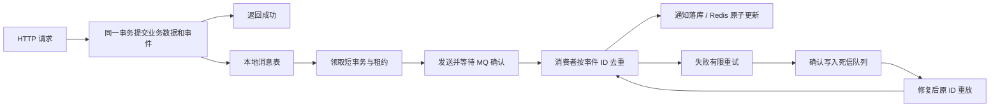

# 互动消息可靠性处理与验证

本轮优先处理“写库成功但消息丢失”“消费者重试/重复投递不可靠”，覆盖新产生的点赞、取消点赞、评论发布的作者通知与热度事件。最新版本通过真实故障检查及 100/300 并发的 8,000 次正常写入，最终记录、计数、Redis 热度、通知均对齐；不能据此宣称全站所有链路或生产容量已经验收。

## 实现

1. **业务行与消息同事务提交。** 新增 `outbox_events`；每次互动的通知事件和热度事件一次批量插入，与业务行、计数变更一起提交或回滚。MQ 不可用时仍保留待发事件，不依赖请求结束后“记一条日志”。
2. **确认发布后才标记完成。** 发布携带稳定事件 ID、持久消息标记，等待 broker confirm，并检查 mandatory return。建立所有必要绑定后才发布，防止只匹配到业务队列而漏掉通知队列。失败保留原 ID，按 1/2/4/8/16/32 秒退避重试。
3. **短事务领取与恢复租约。** `FOR UPDATE SKIP LOCKED`、批量租约、租约令牌防止同时领取；租约过期 2 分钟后可以恢复进程崩溃遗留的工作。网络发送在数据库事务之外完成，确认状态批量写回。发布后、本地标记前崩溃仍可重复投递，依靠消费者去重处理。
4. **通知按事件 ID 去重。** `notifications.event_id` 为可空唯一索引，保留历史 NULL 行兼容性。重复事件不重复插入或重复推送 SSE。历史无 ID 消息使用载荷指纹兼容，无法完美区分两个完全相同的历史载荷。
5. **热度原子更新。** Redis Lua 先检查类型，再完成去重、累加、失效时间和详情缓存失效；错误向上传递。按事件发生时间写入分钟窗口；标记比该窗口多保留一小时，过期事件不重新生成旧窗口。
6. **有限重试和确认后的隔离。** 消费者首次失败后最多重试 3 次，间隔 250ms、1s、3s，不再将立即重排队误当成 `x-death` 计数。耗尽后通过默认交换机确认写入本消费者的 `.dlx` 队列，再确认原消息；隔离发布失败则原消息保持未确认。保留来源队列、交换机、路由和事件 ID，避免新失败事件被历史共享 DLX 的 `#` 绑定扇出到无关 DLQ。
7. **断线恢复。** API 的通知消费者、Worker 的互动消费者自动重连 RabbitMQ。Worker 启动时 Redis 暂不可用也保留客户端，处理失败会重试/隔离，不静默关闭热度消费。

当前发布线程运行在 API 进程中；API 退出期间待发事件保留，新 API 实例启动后恢复领取。API、Worker 都需要更新到对应版本，并使用一致的数据库和时区配置。新表与唯一索引由现有 AutoMigrate 初始化。



## 修复过程中确认的范围锁竞争

初版使用 MySQL 默认隔离级别领取消息，锁定扫描的间隙可能阻塞 HTTP 事务插入新事件。逐条写回发布状态也增加了提交开销；已改为批量插入事件、批量领取、批量标记，并将事件插入放到热点计数更新前，缩短热点行锁持有时间。

最终仅将消息领取和完成标记这类后台短事务改为 `READ COMMITTED`，业务写入事务维持原设置。`TestClaimDoesNotBlockNewBusinessEvents` 在领取事务仍持有锁时插入新事件：当前实现通过；通过 Go overlay 将同一实现切为 `REPEATABLE READ` 的对照测试在 2 秒后因插入阻塞失败。对照文件在 `backend/.run/p0/rr-control/`，没有改写正式源文件。

该隔离对照确认了此处锁竞争，不表示各轮吞吐差异都能归因于某一个参数或排除同机负载波动。

## 最新真实验证

目录：`results/20261023-183641`，项目 `feedsystem-p0-reliable-rc`。Windows 原生 API、Worker 与 Go 压测器，Docker MySQL 8 / Redis 7 / RabbitMQ 3.12；6,000 个账号和独立作者、50,000 条初始视频。真实会话鉴权和限流保留，HTTP 客户端超时仍为 3 秒。

### 故障与重复投递

| 检查 | 结果 |
|---|---|
| 仅停止测试项目 RabbitMQ，分别发送 20 次点赞和 20 次评论 | 40/40 HTTP 成功，80 条待发事件保留 |
| 恢复 RabbitMQ，不重启 API/Worker | 待发事件清空，20 条点赞/20 条评论的记录、计数、热度、通知全部对齐 |
| 无匹配路由的发布 | 明确返回失败，不误当作可靠发布成功 |
| 重复投递已处理的点赞/热度事件各 5 次 | 点赞通知仍为 20，热度仍为 20 |
| Redis 测试分钟键设为错误类型 | 更新错误传递；首次处理和 3 次重试后进入指定死信队列，没有写入“已处理”标记 |
| 修复该测试键后，将同一个热度事件重放 5 次 | 原始增量为 7，最终热度仍为 7；队列收敛为空 |

### 正常写入

| 操作 | 并发 | 成功/请求 | 有效 RPS | HTTP P99 | 最终核对 |
|---|---:|---:|---:|---:|---|
| 点赞 | 100 | 2,000/2,000 | 167.2 | 815.4 ms | 通过 |
| 评论 | 100 | 2,000/2,000 | 167.6 | 685.5 ms | 通过 |
| 点赞 | 300 | 2,000/2,000 | 191.9 | 1,658.9 ms | 通过 |
| 评论 | 300 | 2,000/2,000 | 186.7 | 1,802.4 ms | 通过 |

正常写入共 8,000/8,000 成功，其中 300 并发为 4,000 次。另有 20 次同账号并发点赞全部返回成功，最终仅一条点赞、一次数据库/Redis 热度、一条通知。最终 `outbox_pending=0`，队列 ready/unacked 总计为 0。

批次收尾观察约 7.3–13.8 秒，包括本地事件发送、消费者处理和管理接口统计延迟，不能当成单条通知延迟或通知 P99。读取阶段本轮仅每组 5 秒：100/300 并发登录和冷数据 Feed 均无失败，300 并发有效 RPS 约 5,959/8,630；它们只是短窗口检查。前后各 120 页跨冷热边界检查通过。

### 回归与其他检查

- 设置隔离 MySQL DSN 后，`go test ./...` 通过。新增用例覆盖事务回滚、无 MQ 时事件保留、并发租约、过期租约恢复、已确认发布但完成标记失败后的原 ID 重发、消息领取不阻塞新插入、通知并发去重、Redis 重试去重与过期窗口、有限重试和隔离确认。
- MySQL 测试连接启用与实际应用一致的 `interpolateParams=true`，覆盖 JSON 字符串参数编码。
- `go vet ./cmd/... ./internal/events ./internal/worker ./internal/video ./internal/middleware/...` 通过；`git diff --check` 通过。
- 死信重放 CLI 编译及空队列连接检查通过；带消息重放的确认/去重核心流程由上面的真实故障检查验证。
- Windows 竞态检测测试进程仍以 `0xc0000139` 退出，没有完成 race 验证，不能记为通过。

## 保留的失败证据

- `results/20261023-175834`：JSON 字节参数在实际参数插值路径下出现 MySQL 3144；改用 JSON 字符串字段，并对齐集成测试连接配置后修复。
- `results/20261023-180153`：停机写入成功，但旧验证器只看队列统计而过早结束；不计为恢复通过。验证器现同时等待待发事件、通知、热度和队列收敛。
- `results/20261023-180613`：修正后的故障检查通过，尚未做本轮最终性能优化。
- `results/20261023-181055`、`results/20261023-182229`：中间实现 300 并发写入出现大量超时，不算通过；不能用“最终记录对齐”掩盖 HTTP 失败。之后完成批量写回及范围锁修复，才得到最新通过结果。
- 一次普通回归被切换测试容器打断，随后在依赖保持运行时完整重跑通过；没有将中断批次计为通过。

## 复现与操作

使用新的专用项目名，端口空闲后，从仓库根目录执行：

```powershell
./test/load/run-p0.ps1 -ProjectName feedsystem-p0-reliable-next -FaultChecks -Seconds 5 -Levels '100,300' -Cases 'feed_auth_hot,feed_anon_cold'
```

故障检查先核对 Compose 归属标签，只停止所选测试项目的 RabbitMQ。它会修改自己的夹具，并修复自己制造的 Redis 错误类型键。与只读模式互斥，拒绝非专用项目；不会删除已有容器或数据。

修复依赖/数据问题后，从 backend 目录按目标环境 CONFIG_PATH 重放有限批次：

```powershell
go run ./cmd/replay-dlq -queue video.popularity.events -limit 10
```

重放保留 ID 和来源，确认重新发布后才确认原死信。旧格式缺少匹配来源元数据的死信会被拒绝，留待人工判断。部署时监控本地待发事件的数量、最老创建时间、LastError、死信数量；已投递事件保留供审计，需要明确留存/归档策略。

## 尚未覆盖

本轮不关闭 Windows 本机入口的突发连接拒绝、长期持续负载、多实例端到端容量及竞态检查环境问题。没有验证 Redis 数据全量丢失后的缓存重建；缓存去重保证依赖标记留存。视频发布旧时间线 Outbox、关注生产端和 @ 提醒流程没有统一迁移到新消息表，不能将此次结果泛化到这些链路。评论 HTTP 请求的任意超时重试也未引入客户端幂等键，消息重投去重不等于所有重复 HTTP 请求都只创建一条评论。
